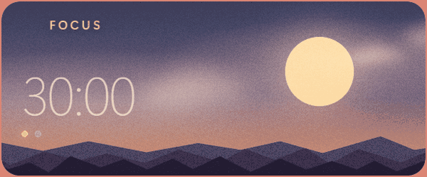
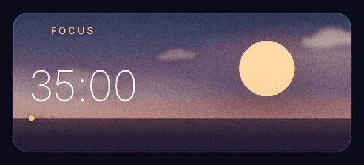
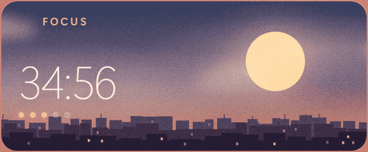
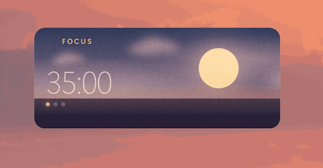
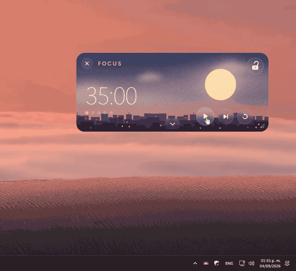
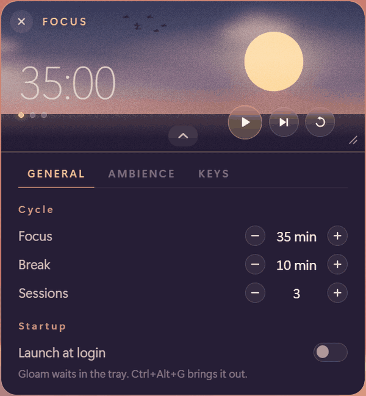
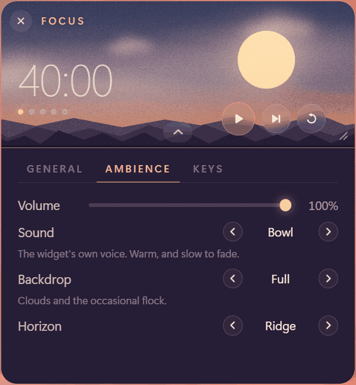

# Gloam

Un temporizador de enfoque flotante y ambiental que vive en una esquina de tu
pantalla.

<p align="center">
  <a href="README.md">English</a> · <strong>Español</strong>
</p>

<p align="center">
  
</p>

<p align="center">
  <a href="https://github.com/damondrc/gloam/releases/latest">
    
  </a>
  <a href="https://github.com/damondrc/gloam/actions/workflows/ci.yml">
    
  </a>
  <a href="LICENSE">
    
  </a>
</p>

Gloam no es una ventana a la que cambias. Es un widget pequeño, siempre
encima de todo, que se queda en una esquina del monitor y lleva los tiempos de
enfoque y descanso mientras trabajas. El fondo avanza por el atardecer a
medida que pasa la sesión: el sol baja hacia el horizonte mientras te
concentras y la luna sube mientras descansas. Con una mirada sabes más o menos
cuánto falta, antes de leer un solo número.

El ambiente es decorativo y periférico, nunca interactivo. No hay nada que
toquetear, y esa es justamente la idea: la mayoría de las apps de enfoque son
o un gestor de tareas con una cuenta regresiva pegada o una escena que pide
que la mires, y las dos son una cosa más a la que prestarle atención.

Las grabaciones de esta página muestran la interfaz en inglés. Gloam habla
español desde la versión 1.2; más abajo está [cómo elegir el idioma](#ajustes).

## Descargar

Los instaladores están en la
[última versión](https://github.com/damondrc/gloam/releases/latest): un `.exe`
para Windows y un `.deb` para Linux, con un `SHA256SUMS.txt` al lado.

Gloam no tiene firma de código, así que Windows muestra un aviso de SmartScreen
la primera vez que abres el instalador. La suma de verificación es la
respuesta honesta a eso, y vale la pena revisarla antes de continuar:

```powershell
Get-FileHash .\Gloam_x.y.z_x64-setup.exe -Algorithm SHA256
```

```bash
sha256sum -c SHA256SUMS.txt --ignore-missing
```

## Qué hace

<p align="center">
  
</p>

<p align="center"><em>Una sesión de enfoque y el descanso que le sigue, a unas
doscientas veces su velocidad: la única forma de ver de un vistazo lo que
normalmente toma cuarenta y cinco minutos. Lo único que se apura es el reloj.
Las nubes, la bandada y el titileo van a su velocidad real, que es la
diferencia entre un fondo ambiental y uno recargado.</em></p>

- **El cielo es la barra de progreso.** El sol baja mientras te concentras y
  la luna sube mientras descansas, así que el tiempo que falta se entiende sin
  leerlo.
- **Ciclos de enfoque y descanso a tu medida**, con un plan que siempre
  termina en enfoque. Un descanso al final no lleva a nada, así que es tiempo
  muerto.
- **Un horizonte a elegir**: mar abierto, una ciudad cuyas ventanas se
  encienden a medida que oscurece, o una cordillera. Generados, no dibujados.
- **Nubes, una bandada de vez en cuando y una estrella fugaz todavía más
  rara.** Lo que se mueve todo el tiempo va lo bastante lento como para no
  llamarte la atención, y lo rápido es tan escaso que se disfruta en vez de
  distraer.
- **El modo bloqueo** atenúa el widget hasta dejarlo como una marca de agua y
  deja pasar los clics a lo que haya debajo.
- **El modo compacto** lo pliega en una sola fila, y la esquina permite
  escalarlo entero del 80 % al 180 %.
- **Un ícono en la bandeja**, para guardarlo sin detener el ciclo y
  encontrarlo de nuevo si queda en algún lugar inalcanzable.
- **Reproduce una carpeta con tu propia música**, decodificada dentro de la
  app y no a través del motor del navegador, así que el FLAC funciona sin
  buscar códecs. Se hace a un lado cuando Gloam tiene algo que decir y sigue a
  tus audífonos.
- **Sonidos suaves y sintetizados** para su propia voz: sin archivos de audio
  incluidos y sin sustos.
- **En español y en inglés.** Sigue el idioma de tu sistema, o el que elijas.
- **Se abre al iniciar sesión** si se lo pides, en la bandeja y no en medio
  de la pantalla.
- **Sin cuentas, sin red, sin estadísticas.** Gloam no abre ninguna conexión.

## Cómo se usa

Arrástralo desde cualquier parte: no tiene barra de título. Los controles
aparecen cuando el puntero pasa por encima y se van cuando sale, así que en
reposo se ve como parte del paisaje.

| Tecla | Acción |
| --- | --- |
| `Espacio` | Iniciar / pausar |
| `C` | Modo compacto |
| `S` | Abrir o cerrar el panel |
| `+` / `-` | Agrandar o achicar el widget |
| `Ctrl+Alt+G` | Bloquear o desbloquear, desde cualquier lugar |

La lista es corta a propósito: una tecla solo se asigna si lo que hace se
puede deshacer y se puede hacer de otra forma, así que saltar, reiniciar y
bloquear son botones. Gloam está encima de todo y puede tener el foco del
teclado sin que lo pienses como la app en la que estás, y una ventana así no
debería poder tirar una sesión porque le escribiste una letra.

### Modo bloqueo

<p align="center">
  
</p>

<p align="center"><em>El texto de abajo se está seleccionando a través del
widget. Esa es toda la función: el candado es el único hueco en una superficie
que deja pasar todo lo demás.</em></p>

Un widget siempre encima es cómodo en un segundo monitor e incómodo en uno
solo, donde tapa lo que estás leyendo. El candado le pasa cada clic a la
ventana de abajo y deja a Gloam como una marca de agua, salvo en el candado
mismo, así que siempre hay una forma de volver. `Ctrl+Alt+G` es una segunda,
y funciona desde cualquier lugar.

### Modo compacto

<p align="center">
  
</p>

Un doble clic pliega el widget al reloj, el botón de inicio y el candado.
Saltar, reiniciar y cerrar no se achican, se quitan: por debajo de unos 24 px
un botón deja de valer la pena apuntarle. Siguen disponibles desde el
teclado.

### La bandeja

<p align="center">
  
</p>

<p align="center"><em>Lo que hay que mirar es el reloj. Marca 35:00 antes de
guardar el widget y 34:43 cuando vuelve: el ciclo nunca se detuvo, solo
estaba fuera de vista.</em></p>

Cerrar oculta el widget y el ciclo sigue. `Restablecer posición` lo devuelve a
su esquina, que es la salida si lo arrastraste a un lugar incómodo o lo dejaste
en un monitor que ya no está conectado. Salir de verdad es la última opción
del menú.

Algunos escritorios no tienen bandeja, y varios entornos de Linux la traen
desactivada. Donde no se puede crear el ícono, cerrar vuelve a significar
salir, y el aviso del botón de cerrar dice cuál de las dos cosas va a hacer.

## Ajustes

La flecha del borde inferior despliega un panel debajo del horizonte: el cielo
es el temporizador y el suelo es donde vive la maquinaria.

<p align="center">
  
  
</p>

| Pestaña | |
| --- | --- |
| **Ciclo** | Cuánto dura un ciclo: enfoque, descanso y cuántas sesiones. Nada más, porque es la que se abre antes de cada sesión. |
| **Música** | Qué carpeta reproducir, a qué volumen, en orden aleatorio y con fundido. |
| **Ajustes** | Todo lo que se configura una vez y se deja así, como una lista corta que abre una página por línea. |

| Ajustes | |
| --- | --- |
| **Ambiente** | Cómo es tenerlo al lado: el volumen, el material con el que suena, qué tan vivo está el cielo y qué hay en el horizonte. |
| **Idioma** | English o Español. En **Sistema**, Gloam habla el que prefiera tu sistema de los dos, e inglés si no prefiere ninguno. |
| **Arranque** | Si el equipo abre Gloam por su cuenta. |
| **Teclas** | Todos los atajos, y la forma de volver a ver el recorrido. |

Cada línea de la lista dice cómo está configurada, así que la mayoría de las
veces no hace falta abrirla.

**Sonido.** Tres conjuntos, cada uno con un instrumento, una frase y un juego
de sonidos para los botones, elegidos juntos y nombrados por su material.

| | |
| --- | --- |
| **Cuenco** | La voz propia del widget. Cálida, de dos notas, y tarda en apagarse. |
| **Campana** | Metal, en tres notas. Difícil de pasar por alto. |
| **Fieltro** | Madera y fieltro que se desvanecen. Apenas se oye. |

**Fondo.** Tres modos que responden a tres preguntas distintas, no tres grados
de lo mismo.

| | |
| --- | --- |
| **Completo** | Nubes y, de vez en cuando, una bandada. |
| **Sereno** | Solo nubes. Nada cruza rápido. |
| **Ligero** | Un cielo plano, para un equipo modesto. |

**Horizonte.** Lo que es el cuarto inferior del widget, no algo parado encima.

| | |
| --- | --- |
| **Agua** | Una franja plana. Como Gloam se vio siempre. |
| **Ciudad** | Una ciudad que se enciende a medida que oscurece y se apaga durante el descanso. |
| **Cordillera** | Tres cadenas de montañas a tres distancias. |

**Música.** Dale a Gloam una carpeta y reproduce lo que haya en ella (FLAC,
MP3, Vorbis, WAV o AAC), con anterior, reproducir y siguiente en el frente del
widget y el nombre de la pista al lado. La pestaña Música puede ponerla en
orden aleatorio y unir cada pista con la siguiente con un fundido de cinco
segundos. Una carpeta, sin subcarpetas, en el orden de los nombres de archivo:
una biblioteca necesita más de tres botones para recorrerse, y en ese punto
deja de ser un temporizador que reproduce música.

La decodificación ocurre dentro de la app y no a través del motor del
navegador, por eso el FLAC funciona en un equipo que no tiene el códec. La
música tiene su propio volumen, baja mientras Gloam habla en lugar de competir
con él y se cambia contigo cuando conectas audífonos. Tu carpeta se lee y
nunca se modifica, y nada suena hasta que presionas reproducir, tampoco
después de reiniciar.

Lleva el tiempo junto con el temporizador sin que el temporizador la maneje.
Pausar o reiniciar el temporizador pausa la música, y al seguir vuelve, salvo
que la hayas pausado tú, en cuyo caso se queda pausada. Al terminar un ciclo
se apaga con la alarma y espera. Los descansos no la tocan: un descanso es
parte de la sesión, no una interrupción.

**Abrir al iniciar sesión** arranca Gloam en la bandeja y no en la pantalla:
un widget es algo que vas a buscar, y el sistema que inicia tu sesión no es
una persona yendo a buscarlo. En un escritorio sin bandeja se abre en la
pantalla, y la línea debajo del interruptor dice cuál de las dos cosas va a
pasar.

**Idioma.** Gloam arranca en el idioma de tu sistema si es español o inglés,
con cualquier región, y en inglés si no es ninguno de los dos. En
**Ajustes → Idioma** puedes elegir uno a mano, y entonces se mantiene aunque
el sistema cambie. Cada idioma aparece con su propio nombre, así que la forma
de volver se lee desde cualquiera de los dos. FOCUS, BREAK y DONE quedan en
inglés en los dos idiomas: se leen como marcas del cielo más que como
palabras.

## Dónde se abre

La primera vez, abajo a la derecha y al 150 %: dentro del área útil, no
detrás de la barra de tareas, y lo bastante grande como para leerlo de un
vistazo desde el otro lado del escritorio. Y se presenta una sola vez: cuatro
pasos, cada uno se puede seguir mientras lo explica, y nunca más, salvo que lo
pidas desde **Ajustes → Teclas**.

Después recuerda dónde lo dejaste, y antes de usar esa posición la compara con
las pantallas que de verdad están conectadas: desconectar un monitor es algo
normal en una laptop.

## Plataformas

| | Estado |
| --- | --- |
| Windows 10/11 | Compatible, verificado con 1.0.0 |
| Linux · X11 | Compatible, verificado con 1.0.0 |
| Linux · Wayland | Sin probar |
| macOS | Nunca se ejecutó |

Estas filas dicen lo que alguien comprobó en un equipo real, siguiendo
[una lista escrita](docs/platform-testing.md) que se recorre antes de cada
versión. Donde nadie la recorrió, lo dicen en vez de adivinar.

Los paquetes de Linux se construyen dentro de un contenedor de Ubuntu 22.04 y
se espera que funcionen en **Ubuntu 22.04, Debian 12 y Mint 21** o más
nuevos. Un `.deb` y nada más por ahora: Fedora, openSUSE y Arch todavía no
tienen paquete, y [llevárselo](docs/open.md) está en la lista de pendientes,
no a medio hacer.

## Hecho con

**Tauri 2**, **Svelte 5** y **TypeScript**. El ejecutable pesa unos pocos
megabytes y en reposo usa una fracción de la memoria que necesitaría un
equivalente en Electron, lo que importa en algo pensado para estar abierto
todo el día.

Todo lo nuevo llega como algo que se despliega: **el estado por defecto nunca
se vuelve más recargado.** Un Gloam con todos los ajustes activados se sigue
viendo como la grabación del principio de esta página hasta que le pides más.

Ausente a propósito, y así se queda: estadísticas y rachas, un editor de
escenas, notificaciones y cualquier cosa conectada a la red.

## Para leer más

El resto de la documentación está en inglés.

| | |
| --- | --- |
| [How it works](docs/architecture.md) | Las decisiones y lo que descartaron. El paso de clics, el sistema de escala, el diseño de sonido, los horizontes generados y qué se prueba y por qué. |
| [Contributing](CONTRIBUTING.md) | Cómo compilarlo, y la vara que tiene que pasar una función nueva. |
| [Security](SECURITY.md) | Lo que Gloam no hace y cómo reportar algo. |
| [Platforms](docs/platforms.md) | Lo que se sabe de cada plataforma, y cómo se sabe. |
| [Open threads](docs/open.md) | Todo lo que el proyecto dijo que retomaría. |
| [Changelog](CHANGELOG.md) | Qué cambió, versión por versión. |

## Licencia

MIT. Mira [LICENSE](LICENSE).
